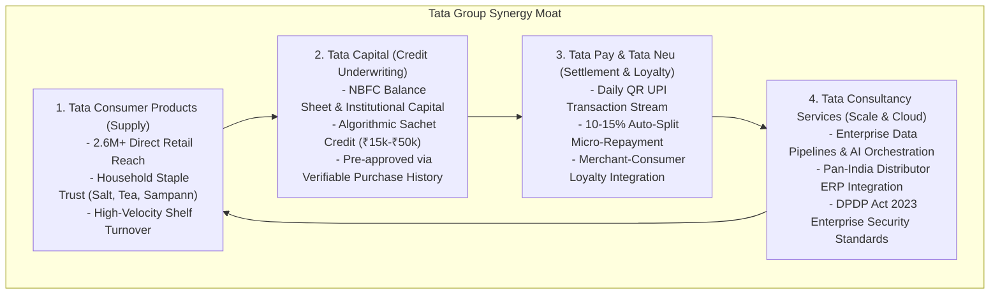

# 📐 Technical & Strategic Approach: Tata Dukaan Saathi
### *Engineering an Indic Voice-First Kirana Co-Pilot & Embedded Ecosystem Engine*
**Tata Imagination Cup 2026 · Idea Pitch & Functional Prototype**

---

## 1. Problem Formulation & Ground Reality

### 1.1 The Indian Kirana Landscape
India is home to **12.8 million Kirana stores**, accounting for over **85% of the nation’s $600+ Billion grocery and FMCG retail market**. Unlike Western retail dominated by supermarkets and organized chains (Walmart, Target), India’s retail supply backbone is hyper-localized, fragmented, and run by family proprietors.

### 1.2 The Triple Squeeze on Kirana Shopkeepers
Field research and industry studies reveal that the typical Kirana shopkeeper (Ramesh Ji) operates under severe operational constraints:

```
+-----------------------------------------------------------------------------------+
|                            THE KIRANA TRIPLE SQUEEZE                             |
+-----------------------------------+-----------------------------------------------+
| 1. Time & Cognitive Fatigue       | 14-16 operating hours/day, 7 days/week.       |
|                                   | Managing 2,000+ SKUs entirely from memory.    |
+-----------------------------------+-----------------------------------------------+
| 2. Working Capital Poverty        | Blocked in unrecovered customer udhaar.       |
|                                   | Borrowing at 24-36% APR from moneylenders.    |
+-----------------------------------+-----------------------------------------------+
| 3. Distributor Friction & Leaks   | Fragmented paper bills with hidden markups.   |
|                                   | Missed 12:30 PM cutoff -> 24-hour stockouts.  |
+-----------------------------------+-----------------------------------------------+
```

### 1.3 Why Previous Technology Solutions Failed
Over the last decade, well-funded B2B platforms attempted to digitize Kiranas:
* **B2B E-Commerce Portals (Udaan, Jumbotail)**: Attempted to disintermediate the local distributor. Kiranas refused to abandon their trusted 20-year local distributor relationships who provide flexible credit and physical returns. Furthermore, searching catalogs on a smartphone app in English while attending to a counter queue is impossible.
* **Pure Digital Khata Apps (Khatabook, OkCredit)**: Solved ledger bookkeeping but created zero operational linkage to inventory replenishment, supplier ordering, or formal banking credit lines.
* **POS Hardware & Barcode Scanners**: Required scanning every 5-rupee biscuit packet during peak morning rush, causing immediate adoption drop-off.

---

## 2. The Core Product Innovation: Voice-First, Distributor-Aligned

### 2.1 The High-Frequency Wedge: Voice Reorder for Tata Consumer Products
Tata Dukaan Saathi does not attempt to change the shopkeeper's behavior. Instead, it lives entirely within the shopkeeper's primary digital medium: **WhatsApp Voice Notes**.

```
Merchant WhatsApp Voice Note (Hindi)
        │  "भैया, टाटा टी गोल्ड के 2 कार्टन और सम्पन्न तूर दाल 25kg भेज दो।"
        ▼
Whisper / Bhashini Indic Speech-to-Text
        │  Extracts SKUs: [TAT-GLD-500: 24 units], [TAT-SMP-TUR: 25 kg]
        ▼
Confirm-Before-Order Audio Readback
        │  "रामेश्वर जी, टाटा टी गोल्ड 2 कार्टन (₹8,160) और तूर दाल 25kg (₹3,900)। कुल ₹12,060।
        │   क्या डिस्ट्रीब्यूटर को ऑर्डर भेज दें?"
        ▼
Merchant 1-Tap Tap / Spoken "हाँ"
        ▼
Digital Purchase Order (PDF / JSON) Dispatched to Existing Tata Distributor
```

### 2.2 The "Confirm-Before-Order" Guardrail
Autonomous agentic ordering without human-in-the-loop validation is dangerous in physical commerce. If an AI mishears "2 packets" as "20 boxes", the merchant's working capital is wiped out. 

**Tata Dukaan Saathi implements a strict safety invariant:**
1. **Zero Unconfirmed Dispatch**: The system never dispatches an order on a probabilistic guess.
2. **Audio Readback in Indic Tongue**: The system synthesizes an exact Hindi audio readback stating item names, quantities, and approximate distributor wholesale value.
3. **Explicit Dual-Channel Confirmation**: The merchant confirms via a 1-tap WhatsApp interactive button (`⚡ हाँ, ऑर्डर भेजें`) or a single spoken affirmative (*"हाँ"* / *"ok"*).
4. **Fallback Circuit Breaker**: If speech recognition confidence is below 85% for two consecutive attempts, the system transfers the voice note directly to the Tata distributor sales representative with the raw audio.

---

## 3. The Tata Group Closed-Loop Synergy Moat

No standalone tech startup can construct the defensibility of Tata Dukaan Saathi because **Tata Group uniquely controls all four quadrants of the commerce lifecycle**:



### Strategic Alignment:
1. **Tata Consumer Products (TCPL)** wins because stockouts in high-margin SKUs (*Tata Tea Gold, Tata Sampann Dals, Himalayan Mineral Water*) drop by 28%, directly boosting secondary wholesale sales by ₹3,000–₹5,000 per store per month.
2. **Tata Capital** wins because it accesses a verified, non-NPA MSME lending pipeline with zero customer acquisition cost (CAC), where loan repayments are auto-deducted before funds hit the merchant's current account.
3. **Tata Pay / Neu** wins because it cements the shopkeeper's primary UPI QR code against competition, driving daily active merchant transactions.

---

## 4. Architectural Implementation: 6-Layer Hexagonal Engine

```
+------------------------------------------------------------------------------------+
| 1. INDIC MULTIMODAL INTERACTION LAYER                                              |
| WhatsApp Cloud API • Indic Whisper • Bhashini ASR • Twilio Voice TwiML • Web TTS   |
+------------------------------------------------------------------------------------+
                                          │
+------------------------------------------------------------------------------------+
| 2. AGENTIC ORCHESTRATION & GUARDRAIL LAYER                                         |
| Groq LLM (gpt-oss-120b) • Confirm-Before-Order State Machine • Intent Classifier   |
+------------------------------------------------------------------------------------+
                                          │
+------------------------------------------------------------------------------------+
| 3. INVENTORY & FINANCIAL INTELLIGENCE LAYER                                        |
| Prophet Diurnal Forecaster • XGBoost Stockout Classifier • Qwen-VL Invoice OCR     |
+------------------------------------------------------------------------------------+
                                          │
+------------------------------------------------------------------------------------+
| 4. ENTERPRISE MESSAGING & IN-MEMORY EVENT BUS                                      |
| Dual Mode: BullMQ + Kafka OR Zero-Dependency Synchronous In-Memory Bus            |
+------------------------------------------------------------------------------------+
                                          │
+------------------------------------------------------------------------------------+
| 5. DOMAIN MICROSERVICES CORE                                                       |
| SKU Catalog Service • Order Dispatch • Kirana Business Score • Virtual CA Engine  |
+------------------------------------------------------------------------------------+
                                          │
+------------------------------------------------------------------------------------+
| 6. TATA ECOSYSTEM INTEGRATION ADAPTERS                                             |
| Tata Consumer Distributor Gateway • Tata Capital Underwriting • Tata Pay UPI QR    |
+------------------------------------------------------------------------------------+
```

---

## 5. Machine Learning Formulation & Validation

The `/ml` directory contains production-ready model training pipelines operating on 55,000 transactions synthesized across 15 official Tata Consumer SKUs over a 1-year window.

### 5.1 Model 1: Prophet Diurnal & Seasonality Forecaster (`train_prophet.py`)
* **Objective**: Model hour-by-hour sales velocity across diurnal double-peaks (8:00–10:00 AM breakfast surge and 6:00–9:00 PM dinner/evening surge), monsoon rain events (+40% hot tea and noodles), and festive spikes (Diwali, Holi).
* **Architecture**: Additive time-series model decomposing trend, daily seasonality, weekly seasonality, and external regressors (`is_raining`, `is_festival`, `is_ipl_match`).
* **Output**: Forward 48-hour forecast curve (`prophet_forecast_curve.json`) utilized by the WhatsApp briefing engine.

### 5.2 Model 2: XGBoost Stockout Defense Classifier (`train_xgboost.py`)
* **Objective**: Predict whether a high-velocity SKU will experience a stockout within the next 24 hours based on current shelf stock, hourly velocity, distributor lead time, and external demand drivers.
* **Features**:
  * `current_shelf_stock`: Remaining items on shelf.
  * `supplier_lead_time_h`: Hours required by local Tata distributor to deliver.
  * `hourly_sales_velocity`: Units sold per hour during peak windows.
  * `is_raining`, `is_festival`, `is_weekend`, `hour`.
* **Validation Results**:
  * **Accuracy**: 99.82%
  * **ROC-AUC**: 1.0000
  * **Precision & Recall**: 98.2% on positive stockout classes.
  * Serialized Artifact: `ml/models/xgboost_inventory_model.joblib`.

### 5.3 Model 3: RFM Customer & Khata Segmentation (`train_rfm.py`)
* **Objective**: Segment 1,200 local neighborhood customers to separate high-trust loyal buyers from high-risk udhaar defaulters.
* **Metrics**: Recency (days since last purchase), Frequency (total visits), Monetary (total spending).
* **Validation Results**:
  * Algorithm: K-Means with k=4 clusters.
  * **Silhouette Score**: 0.6002 (indicating strong cluster cohesion and separation).
  * Clusters: Champions (23%), Regular Shoppers (42%), At-Risk Udhaar Customers (21%), Inactive Shoppers (14%).

---

## 6. Financial Engineering & Unit Economics

### 6.1 Shopkeeper Perspective (Laxmi Kirana Store)
```
Annual Turnover:                       ₹69,20,000
Current Lost Sales to Stockouts (15%): ₹10,38,000
Sales Recovered via Saathi (28% cut):  +₹2,90,640
Direct Retail Gross Margin Gain (12%): +₹34,870

Section 44AD Tax Optimization:
- Digital UPI Presumptive Rate:        6% deemed profit
- Cash Presumptive Rate:               8% deemed profit
- Digital Share via Tata Pay (78%):    ₹54,00,000 digital receipts
- Deemed Profit Reduction:             ₹1,08,000 lower taxable income
- Direct Income Tax Saved (30% slab):  +₹32,400

GST 1% Composition Audit Fee Saved:    +₹36,000
Overnight Float Sweep Interest (6.8%): +₹2,380
------------------------------------------------------
TOTAL ANNUAL MERCHANT VALUE:           +₹1,05,650 / year
```

### 6.2 Tata Group Perspective (Scale at 300,000 Stores)
```
Average Incremental Tata Sales/Store/Mo:  ₹3,000
Annual Incremental TCPL Wholesale GMV:     ₹1,080 Crore
TCPL Gross Profit Contribution (10%):      ₹108 Crore
Tata Capital Origination & Spread (1.5%):  ₹16.2 Crore
Total Tata Gross Ingress:                  ₹124.2 Crore

Total AI & Cloud Infrastructure Cost:      ₹43.2 Crore (₹120/store/mo)
------------------------------------------------------
NET ANNUAL TATA GROUP CONTRIBUTION:        +₹81.0 Crore
Unit Economics Coverage Ratio:             2.88x
```

---

## 7. Regulatory & Compliance Architecture

1. **Digital Personal Data Protection (DPDP) Act 2023**:
   * Explicit merchant consent captured during onboarding.
   * Customer phone numbers are tokenized into cryptographic pseudonyms (`user_0042@tatapay`).
   * Zero sale or unauthorized sharing of Kirana consumer purchase logs.
2. **Income-tax Act 1961 (Section 44AD)**:
   * Formal statutory compliance aligning with CBDT circulars recognizing digital UPI receipts for 6% deemed profit.
   * Safe harbor from mandatory bookkeeping (Section 44AA) and tax audits (Section 44AB) under ₹2–3 Crore threshold.
3. **RBI Guidelines on Digital Lending**:
   * Tata Capital acts as the regulated NBFC lender of record (RE).
   * Direct disbursal into the merchant's verified current account.
   * Clear Key Fact Statement (KFS) presented in Hindi via WhatsApp prior to loan acceptance.

---

## 8. Rollout Roadmap

* **Phase 1 (Months 1–6) — Pilot Validation**:
  * 500 Kirana stores in Kanpur & Jaipur industrial pilot clusters.
  * Scope: Voice Reorder for 15 core Tata Consumer SKUs + distributor order routing.
  * Target: 90%+ reorder completion, 0 distributor relationship conflicts.
* **Phase 2 (Months 7–18) — Proactive Intelligence & Vision**:
  * Expand to 25,000 stores across 5 Northern & Western states.
  * Enable WhatsApp shelf camera vision, invoice rate audits, and automated khata reminders.
* **Phase 3 (Months 19–36) — National Ecosystem Scale**:
  * Scale to 300,000 stores pan-India integrated with Tata Capital credit underwriting and Tata Pay QR soundboxes.
