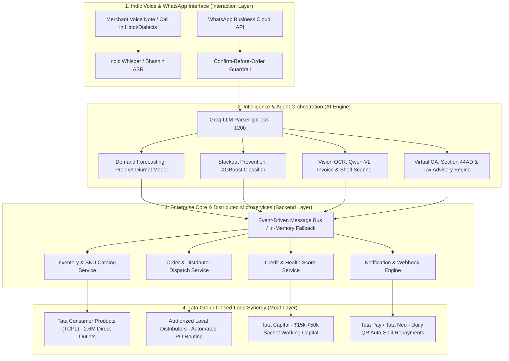
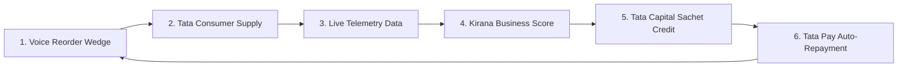

# 🏪 Tata Dukaan Saathi (टाटा दुकान साथी)
### *Autonomous Voice-First Kirana Growth Engine & Embedded Ecosystem Platform*
**Tata Imagination Cup 2026 · Idea Pitch & Functional Prototype**

[](https://github.com/beastzex/Tata_Imagination_Cup-_2026)
[](https://github.com/beastzex/Tata_Imagination_Cup-_2026)
[](https://github.com/beastzex/Tata_Imagination_Cup-_2026)
[](https://opensource.org/licenses/MIT)

---

## 📌 Executive Summary

India's **12+ million Kirana stores** power **85%+ of the country’s $600B+ grocery retail economy**. Yet, the average Kirana shopkeeper works 14–16 hours a day, managing 2,000+ SKUs entirely in their memory or paper diaries. Because they lack predictive inventory tools and formal working capital, they suffer:
1. **15–20% lost sales** from chronic stockouts during peak morning/evening demand.
2. **Informal credit traps**, borrowing at 24–36% APR from local moneylenders for inventory replenishment.
3. **Severe time poverty**, spending 2–3 hours every night placing fragmented manual orders with 15+ different distributor salesmen.

Previous B2B retail apps (Udaan, Jumbotail, Khatabook) failed to capture the Kirana's core workflow because they required **typing, catalog navigation in English**, and attempted to **bypass the shopkeeper's existing distributor relationships**.

**Tata Dukaan Saathi** re-engineers this dynamic from first principles. It is a **voice-first WhatsApp AI business partner** that requires **zero app installation, zero barcode scanning, and zero behavior change**. 

> **The Core Wedge**: *"Bol ke order karo, bina jhanjhat."* A shopkeeper simply sends a 10-second Hindi voice note on WhatsApp (*"Bhaiya, Tata Tea Gold ke 2 carton aur Sampann Toor Dal 25kg bhejo"*). Saathi transcribes the speech, applies a strict **Confirm-Before-Order guardrail**, and transmits an automated purchase order directly to the merchant's **existing authorized Tata Consumer distributor**.

Building upon this high-frequency voice ordering wedge, Saathi activates the full power of the **Tata Group closed-loop ecosystem**:
* **Tata Consumer Products (TCPL)** secures uninterrupted shelf share and eliminates Kirana stockouts.
* **Tata Capital** extends algorithmic, collateral-free sachet credit (₹15,000–₹50,000) underwritten by live purchase telemetry.
* **Tata Pay / Tata Neu** collects micro-repayments via daily digital QR settlements (10–15% auto-split).
* **TCS** orchestrates pan-India cloud distribution, real-time analytics, and enterprise data security.

---

## 🎯 Key Innovation Highlights

| Capability | Legacy Approach (Apps & Portals) | Tata Dukaan Saathi Innovation |
| :--- | :--- | :--- |
| **Interface** | Complex mobile app, dropdown menus, English UI | **100% WhatsApp Voice Notes & Natural Hindi Speech** |
| **Safety Guardrail** | Blind click or accidental cart checkout | **Confirm-Before-Order**: Verbal Hindi readback + 1-tap confirmation |
| **Supply Chain** | Bypasses local distributors, creating friction | **Empowers existing Tata distributors** with clean digital WhatsApp POs |
| **Inventory AI** | Manual stock counting & spreadsheet inputs | **Prophet Diurnal Forecasting + WhatsApp Shelf Camera Vision** |
| **Invoice Audit** | Paper bills stacked in drawers, hidden overcharges | **Qwen-VL Vision OCR** cross-checks distributor rates against Tata master price list |
| **Credit Underwriting**| 3 years of audited ITRs & bank statements (unobtainable) | **Kirana Business Score (0–100)**: Underwritten via live purchase & UPI velocity |
| **Loan Repayment** | Fixed monthly EMIs triggering bank bounces | **Daily Tata Pay QR Micro-Splits** (10–15% deduction on incoming customer UPI) |

---

## 🏗️ 4-Layer System Architecture



---

## 🏆 The Tata Ecosystem Flywheel

No standalone startup (Udaan, Khatabook) or payment gateway can replicate this solution because **no single competitor owns the complete four pillars of the commerce loop**:



1. **Supply Advantage (Tata Consumer Products)**: TCPL commands unmatched brand trust with essentials like *Tata Salt, Tata Tea Premium, Tata Tea Gold, Tetley, Tata Sampann (Dals, Poha, Spices), Tata Coffee Grand, Himalayan Mineral Water, Ching's Secret, and Tata Soulfull*. Saathi ensures zero stockouts on high-velocity SKUs.
2. **Credit Advantage (Tata Capital)**: Kiranas lack formal credit histories. Saathi constructs an algorithmic **Kirana Business Score (0–100)** derived from transaction consistency, stock turnover, and distributor order cadence, unlocking pre-approved ₹15,000–₹50,000 working capital lines.
3. **Repayment Advantage (Tata Pay / Tata Neu)**: Instead of high-friction monthly cheques, loans are recovered frictionlessly via 10–15% automated splits from daily customer QR receipts.
4. **Distribution & Trust Advantage (TCS)**: High-availability cloud infrastructure, enterprise telemetry, DPDP Act 2023 compliance, and scalable integration across India's Tier-2, Tier-3, and rural hubs.

---

## 📖 "A Day with Saathi" — User Journey (Ramesh Ji, Jaipur)

* **07:30 AM — Morning Audio Briefing**: As Ramesh Ji rolls up the shutters, Saathi delivers a 30-second Hindi voice summary: *"नमस्ते रामेश्वर जी! कल आपकी कुल बिक्री ₹18,400 रही। आज दोपहर बारिश की संभावना है—टाटा टी गोल्ड के 12 पैकेट और चिंग्स नूडल्स का बफर तैयार रखें।"*
* **01:30 PM — Afternoon Stockout Defense**: Saathi detects that Tata Tea Gold stock has dropped to 3 units with a 24-hour distributor lead time: *"रामेश्वर भैया, टाटा टी गोल्ड का स्टॉक 3 पैकेट बचा है। शाम को खत्म हो सकता है। क्या डिस्ट्रीब्यूटर को 2 पेटी का ऑर्डर भेज दें?"* Ramesh Ji responds: *"हाँ, भेज दो।"*
* **03:00 PM — Invoice Rate Audit**: Ramesh Ji snaps a photo of a distributor paper delivery slip on WhatsApp. Saathi's vision engine extracts SKU line items, compares them to Tata master wholesale price lists, and flags: *"⚠️ ध्यान दें: टाटा सम्पन्न तूर दाल का बिल ₹156 के बजाय ₹162 लगाया गया है। ₹150 का अधिक चार्ज पकड़ा गया।"*
* **06:00 PM — Evening Khata Recovery**: Saathi identifies ₹14,200 in pending customer udhaar (store credit) overdue past 14 days and generates friendly, customized WhatsApp reminders with 1-tap Tata Pay UPI payment links.
* **10:00 PM — Cash Sweep & Day-End Settlement**: At closing, Saathi audits daily cash receipts, computes Section 44AD deemed profit savings (6% digital vs 8% cash = ₹70,400 saved annually), and sweeps idle night cash into 6.8% liquid funds.

---

## 💻 Tech Stack & Engineering Architecture

### Frontend Experience
* **Framework**: Next.js 16 (App Router), React 19, TypeScript
* **Styling**: Vanilla Tailwind CSS with custom Tata Group Brand Tokens (`#005691` Tata Blue, `#003B66` Deep Navy, `#00A3E0` Cyan Sky, `#F59E0B` Amber Gold)
* **Real-time UX**: Smooth-scroll landing page, live interactive Voice Simulator Lab, What-If Inventory Playground, Virtual CA Hindi tax auditor, and dual-perspective ROI Calculator.

### AI & Indic Speech Core
* **Indic Speech Recognition**: OpenAI Whisper / Bhashini API for Hindi, Hinglish, and regional speech-to-text.
* **LLM Engine**: Groq Cloud with ultra-low latency (`openai/gpt-oss-120b` and `qwen/qwen3.8-27b`) for intent extraction and Hindi text generation.
* **Computer Vision**: Multimodal Vision OCR (`meta-llama/llama-4-scenic-17b` & `qwen-2.5-vl-72b`) for distributor invoice auditing and shelf scan analysis.
* **Speech Synthesis**: Web Speech Synthesis API & Twilio Voice TwiML for Hindi audio generation.

### Machine Learning Engine (`/ml`)
* **Prophet (`train_prophet.py`)**: Time-series demand forecasting modeling diurnal double-peaks (8–10 AM morning rush, 6–9 PM evening peak), monsoon rain surges, and festive spikes across 15 Tata SKUs.
* **XGBoost Classifier (`train_xgboost.py`)**: 99.82% accuracy, 1.0 ROC-AUC stockout early warning model predicting 24-hour stockouts based on shelf stock, velocity, and distributor lead times.
* **RFM K-Means Clustering (`train_rfm.py`)**: 1,200-customer segmentation engine categorizing Kirana shoppers into Champions, Regular Shoppers, At-Risk Customers, and Lost Shoppers.

### Backend Microservices (`/backend`)
* **Language & Runtime**: Node.js 20, TypeScript, Express.js
* **Dual Execution Mode**: Enterprise distributed mode (PostgreSQL + Redis BullMQ + Apache Kafka) OR **Zero-Dependency In-Memory Fallback Mode** (`USE_IN_MEMORY_DB=true`, `USE_EMBEDDED_BUS=true`) enabling instant local execution without external databases!
* **Security & Auth**: Argon2 password hashing, JWT bearer tokens, HMAC-SHA256 webhook signatures, rate limiting, and sanitization middleware.

---

## 📊 Unit Economics & Scale Strategy

```
Pilot District (Kanpur / Jaipur): 500 Stores
3-Year Pan-India Target: 300,000 Stores
```

### Monthly Store-Level P&L
```
Incremental Tata Consumer Sales:       +₹3,000 / store / month
TCPL Gross Margin on Incremental Sales (10%):  +₹300 / store / month
Tata Capital Sachet Credit Spread (1.5% fee):  +₹45 / store / month
-------------------------------------------------------------------
Total Monthly Tata Ecosystem Value:            +₹345 / store / month

Cloud & AI Servicing Cost per Store:
- WhatsApp Business API (15 msgs/day):         -₹85 / store / month
- Groq LLM Inference & Vision Tokens:          -₹25 / store / month
- Cloud Compute & Database (AWS/TCS):          -₹10 / store / month
-------------------------------------------------------------------
Total Servicing Cost per Store:                -₹120 / store / month

Net Contribution per Store:                    +₹225 / store / month
Cost-to-Serve Coverage Ratio:                  2.88x (Sustainable & Profitable)
```

At **300,000 stores**:
* **₹1,080 Crore** annual incremental GMV for Tata Consumer Products.
* **₹1,500+ Crore** active micro-working-capital credit book for Tata Capital.
* **2.6 Million** direct merchant relationships for the Tata Neu ecosystem.

---

## 🔒 Security & Compliance Assurance

* **Zero Hardcoded Secrets**: Strictly audited codebase with 0 exposed API keys, tokens, or credentials.
* **Strict Git Discipline**: Comprehensive `.gitignore` protecting all `.env*` files, build caches, and sensitive keys.
* **DPDP Act 2023 Compliance**: Customer phone numbers and identifiers are pseudonymized (e.g., `user_0042@tatapay`). No biometric or financial credentials stored without consent.
* **Confirm-Before-Order Safety Rule**: Critical safety architecture preventing autonomous erroneous ordering. All distributor orders require merchant confirmation.

---

## 🚀 Quickstart & Setup Guide

### Prerequisites
* **Node.js**: v18.0.0 or higher (v20+ recommended)
* **Python**: v3.10 or higher (optional, for ML model training)
* **npm**: v9.0.0 or higher

### 1. Clone the Repository
```bash
git clone https://github.com/beastzex/Tata_Imagination_Cup-_2026.git
cd Tata_Imagination_Cup-_2026
```

### 2. Configure Environment Variables
Copy the sanitized environment template:
```bash
cp .env.example .env.local
```
*(The platform operates with deterministic local fallbacks out of the box if external Groq or Twilio keys are omitted!)*

### 3. Run Frontend Web Application
```bash
npm install
npm run dev
```
Open **[http://localhost:3000](http://localhost:3000)** in your browser to experience:
* **The Pitch Landing Page**: Interactive story, Voice Simulator, Tata Group Moat, Architecture, and Unit Economics Calculator.
* **The Live Merchant Dashboard (`/dashboard`)**: Prophet diurnal forecasts, XGBoost stockout predictions, Qwen-VL invoice audits, Virtual CA tax advisor, and WhatsApp voice assistant.

### 4. (Optional) Run Enterprise Backend
```bash
cd backend
npm install
npm run dev
```
The backend initializes in **Zero-Dependency In-Memory Mode** and binds to port `4000`.

### 5. (Optional) Re-train ML Models
```bash
python ml/generate_kirana_dataset.py
python ml/run_training_pipeline.py
```

---

## 📄 Repository Structure

```
├── .env.example                  # Sanitized environment configuration template
├── .gitignore                    # Strict security ignore rules
├── APPROACH.md                   # In-depth architectural, ML & business approach
├── SETUP_GUIDE.md                # Comprehensive installation & testing guide
├── SECURITY_AUDIT.md             # Security verification & audit report
├── README.md                     # Flagship project documentation
├── package.json                  # Next.js frontend package definition
├── Dockerfile                    # Multi-stage container deployment file
│
├── ml/                           # Production Machine Learning Pipeline
│   ├── generate_kirana_dataset.py# 55,000 synthetic transaction generator
│   ├── train_prophet.py          # Diurnal time-series forecasting model
│   ├── train_xgboost.py          # 24-hour stockout prediction model
│   ├── train_rfm.py              # Customer segmentation K-Means model
│   ├── run_training_pipeline.py  # End-to-end training orchestrator
│   ├── data/                     # Generated transactions dataset
│   └── models/                   # Serialized model artifacts (.pkl, .joblib, .json)
│
├── src/                          # Next.js 16 Web Application
│   ├── ai/                       # Indic speech, Groq LLM, & Vision OCR engines
│   ├── app/                      # Next.js App Router (Landing page, /dashboard, API routes)
│   ├── components/               # Production UI Components
│   │   ├── dashboard/            # Vision scanners, bill auditors, simulators, CA advisor
│   │   ├── sections/             # Pitch landing sections (Hero, Story, Simulator, Flywheel, Bento)
│   │   ├── ui/                   # PhoneFrame, telemetry strips, radial indicators
│   │   └── whatsapp/             # WhatsApp live chat & Hindi voice call simulator
│   ├── config/                   # Brand color tokens & agent registries
│   ├── data/                     # Mock data, Tata catalogue, & store state
│   ├── lib/                      # ML client bridges & utility functions
│   ├── store/                    # Zustand simulation reactive store
│   └── types/                    # TypeScript interfaces & domain entities
│
└── backend/                      # Distributed Enterprise Backend Core
    ├── package.json              # Monorepo workspace configuration
    ├── docker-compose.yml        # Container orchestration (Postgres, Redis, Kafka)
    ├── database/                 # PostgreSQL & MongoDB schemas
    ├── packages/                 # Shared utilities, auth, database, and types
    ├── services/                 # Microservices (Gateway, Inventory, Merchant, Transactions, etc.)
    └── src/                      # Monolithic fallback server with zero external dependencies
```

---

## 👥 Authors & Acknowledgments

* **Tata Imagination Cup 2026** — Round 3 Idea Pitch & Functional Prototype
* Project: **Tata Dukaan Saathi (टाटा दुकान साथी)**
* Developed with ❤️ for India’s 12 Million Kirana Shopkeepers.
